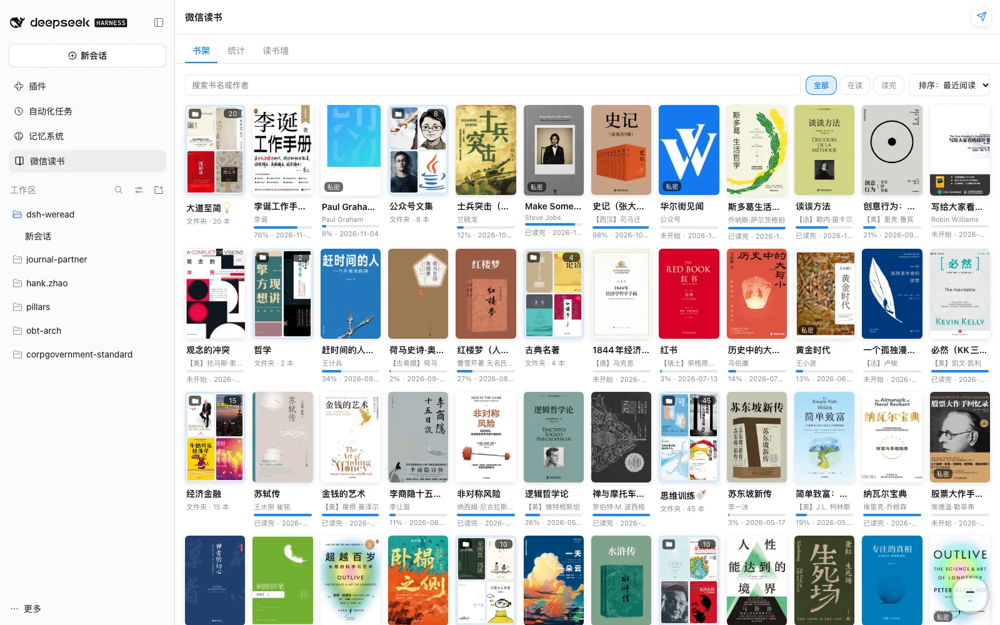
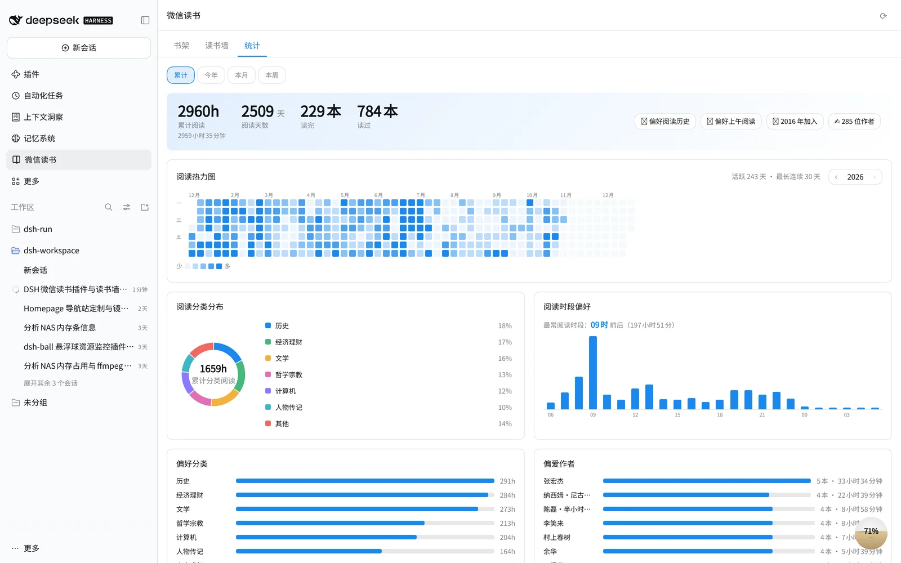
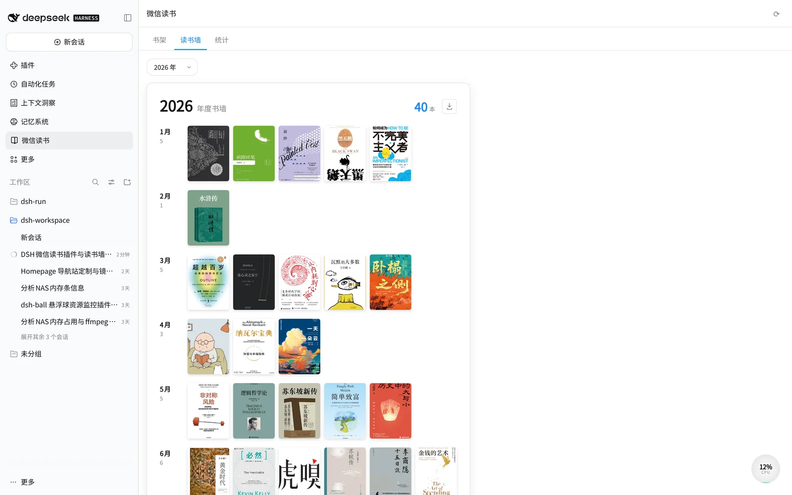

<div align="center">

# 📚 dsh-weread

**在 DeepSeek Harness 里管理你的微信读书书架 · 年度书墙 · 阅读统计 · AI 总结**

[](https://github.com/deepseek-ai/deepseek-harness)
[](./LICENSE)
[](./package.json)

一个原生 [DeepSeek Harness](https://github.com/deepseek-ai/deepseek-harness)（`dsh`）Web 插件：
把你的**微信读书**书架、划线笔记、阅读统计搬进 dsh 界面，并用 dsh 内置模型生成 **AI 阅读总结与画像**。

</div>

---

## ✨ 功能

| | 功能 | 说明 |
|---|---|---|
| 📚 | **书架** | 封面网格；搜索、筛选（在读/读完/有笔记）、排序；**按分类 / 阅读年份分组**；真实阅读进度 |
| 🖼️ | **年度书墙** | 按**月份**拼封面墙，一年一张海报；年份切换；点封面进详情 |
| 📊 | **阅读统计** | 全年**日常热力图**（可切年份）、分类环形图、24 小时时段钟、偏爱作者/出版社、阅读最多、年度趋势 |
| 🤖 | **AI 总结** | 单本总结、划线主题分析、书架阅读画像，走 dsh 的 `ctx.llm` **流式**输出 |
| 🔑 | **API Key 管理** | 仅在 dsh 全局设置里配置，Key 只存宿主侧、浏览器只见掩码 |

## 📷 截图

<div align="center">

**书架** — 封面网格 · 真实阅读进度 · 筛选 / 排序 / 分组



**统计** — 全年热力图（可切年份）· 分类环形图 · 时段钟 · 偏好排行



**年度书墙** — 按月拼封面墙 · 年份切换



</div>

## 🏗️ 架构

dsh 插件是**双半侧**结构（与 `aurora` 插件模板一致）：

```
浏览器 (React 经典脚本 bundle)
  └─ sidebar.panellist 图标 + main 面板  ── fetch('/api/weread/*')
宿主 (Node ESM, Cordis plugin)
  ├─ routes.ts       /shelf /book /chapters /highlights /reviews
  │                  /popular /public-reviews /stats /heatmap /auth /ai
  ├─ weread/gateway  微信读书 Agent Gateway 客户端（Bearer Key · undici + 可选代理）
  ├─ weread/parse    原始响应 → DTO
  ├─ store/cache     LRU + TTL + 请求单飞
  └─ ai/             ctx.llm.stream 流式总结
```

- **认证**：仅 API Key（不依赖 Cookie）。Key 只存 `$DSH_HOME/storages/dsh-weread/config.json`（权限 600），浏览器只见 `wrk-****1234` 掩码。
- **数据代理**：所有微信读书请求都在宿主侧发出，浏览器只访问同源 `/api/weread/*`（认证/路由由 dsh 连接层负责）。
- **AI**：复用 dsh 已配置的模型（默认 `provider=magpie`、`model=workbuddy/deepseek-v4.1-flash`），无需额外密钥。

## 🚀 安装

前提：`DSH_HOME` 已配置（如 `/volume2/docker/dsh/home`），profile 为 `web`。

```bash
git clone https://github.com/zhaohongxuan/dsh-weread.git
cd dsh-weread
npm install --cache ./.npm-cache      # 本机全局 npm cache 属 root 时需换目录
npm run build                         # 产出 lib/index.js + lib/client.js
bash scripts/link-profile.sh web      # 等价 dsh plugin --profile web add --save-prod file:$PWD
```

然后：**dsh Web GUI → 设置 → 插件 → 打开 `dsh-weread` → 刷新页面**。左侧栏会出现「微信读书」入口。

## 🔑 配置 API Key

1. 打开插件面板 → **设置** 标签。
2. 访问 <https://weread.qq.com/api/skills/apikeyGet>（已登录微信读书时直接返回 apikey），复制粘贴到输入框。
3. 点「保存并校验」，显示已授权即可。

> 💡 若提示「网络出口被风控拦截（403）」而 Key 本身有效，是当前出口 IP 被微信读书限制，配置可访问微信读书的代理即可（`config.json` 的 `proxy` 字段）。

## 🧑‍💻 开发

```bash
npm run build        # 构建 host + client
npm run dev          # 监听 src，改动即重建
npm run typecheck    # tsc --noEmit（host 侧）
npm test             # 解析器/配置单测（node --test）
```

浏览器 bundle 只能 `require` dsh 共享模块表的 6 个模块（`react` / `react/jsx-runtime` / `react-dom` / `react-dom/client` / `@deepseek-ai/cordis` / `zod`），图表全部用内联 SVG 手绘，无第三方 UI 依赖。

### 目录结构

```
src/
├── types.ts          两端共享 DTO
├── cordis.ts         cordis 子集类型（含 LLM 服务）
├── host/
│   ├── index.ts       apply：注册所有路由
│   ├── routes.ts      路由表 + 缓存 + 单飞
│   ├── weread/        gateway（Agent API）/ paginate / parse
│   ├── ai/            llm / prompts / handler（流式）
│   ├── store/cache.ts LRU+TTL
│   └── config.ts      凭证与配置（600 文件）
└── client/
    ├── index.ts       注册 sidebar.panellist + main 座位
    ├── shelf.tsx / bookDetail.tsx / bookwall.tsx / stats.tsx / settings.tsx
    ├── charts.tsx     环形图 / 热力图 / 时段钟 / 年度条形（内联 SVG）
    └── styles.css     weread- 前缀，--dsw-* 主题变量
```

## 📄 License

[MIT](./LICENSE)

<div align="center"><sub>Powered by <a href="https://github.com/deepseek-ai/deepseek-harness">DeepSeek Harness</a></sub></div>
